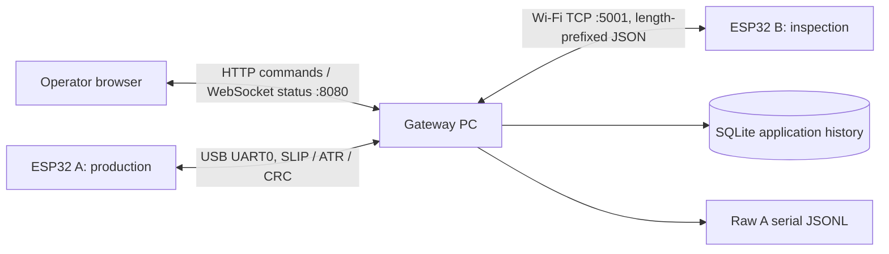
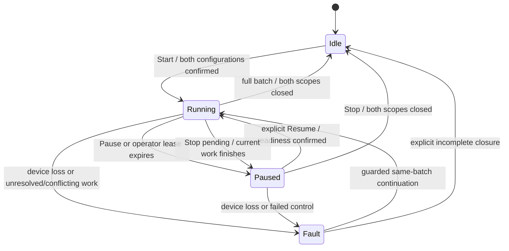

# Architecture and operating states

## Runtime topology

A's USB data cable terminates at the gateway. B's USB cable is power for the
normal application; inspection traffic uses Wi-Fi. The gateway, operator and
B share a reachable LAN. Wireshark on the gateway's Wi-Fi captures both IP
links, while A's framed traffic is captured separately.

## Code ownership

| Component | Responsibility |
|---|---|
| `gateway/operator` | Real HTTP/WebSocket server, controls, full status, browser lease, persistent batch reports and aliases |
| `gateway/production` | A serial client/result validation, serial worker and whole-batch coordination |
| `gateway/inspection` | B TCP adapter, shared operation controller, inspection queue and accounting |
| `stations/production/firmware` | A UART/SLIP/ATR transport and production timer |
| `stations/inspection/main` | B Wi-Fi/TCP transport and inspection adapter |
| `shared/station` | Common C parsing, immutable history, duplicate protection, timers, boot/run fences and retirement |
| `operator_ui` | Existing toy-workshop visuals, controls, estimates and status presentation |
| `tools` | Software verification, explicitly labelled preview, measurement export and packaging |

Both firmware projects compile the same shared lifecycle/parser implementation.
Transport framing stays separate. The browser and gateway do not calculate B's
PASS/FAIL verdict. Decorative cat/puppy alternation does not determine quality.

## Concurrency

One asyncio event-loop thread owns gateway scheduling, TCP, HTTP/WebSocket,
operation controllers and health/deadline decisions. Tasks yield while waiting;
they do not create parallel owners of the same operation.

Blocking USB serial I/O uses a dedicated worker and bounded queues. SQLite and
evidence-file work run off the event loop. Those workers do not independently
retry jobs, decide timeouts or modify batch state. ESP32 firmware timers proceed
independently of gateway acknowledgement receipt and network transmission.

## Part lifecycle and waiting capacity

1. Start validates runtime parameters and configures both stations.
2. The gateway reserves inspection waiting capacity and a durable numeric
   `part_id` before requesting production.
3. Only A's matching, validated completion makes that part available for inspection.
4. B receives the same part identity with an inspection job ID and frozen
   configuration version; it returns its actual result.
5. Confirmed results count once. The batch closes only after both station
   scopes are confirmed closed.

A job executing on B is outside the waiting queue. A reservation can belong
to a part still being produced. **Wait for space** holds before production
and continues the same target as capacity becomes available. **Raise Fault**
holds dispatch instead; already accepted work remains owned by its operation
controller and is not silently cancelled.

## Four operating states

The diagram omits intermediate control details. A station restart may require
explicit binding of its new idle boot before incomplete closure can finish.
Startup configuration, normal closure and Stop waits are pending controls,
not additional states and not automatic Faults.

| Action | Accepted individual jobs | Remaining target | Batch identity |
|---|---|---|---|
| Pause | May finish | Held, including queued inspections | Preserved |
| Resume | No uncertain work silently retried | Continues after readiness checks | Preserved |
| Stop | Finish/recover within finite limits | No new production or queued inspections dispatched | Closed, possibly Incomplete |
| New Start | New configuration and jobs | New target | New identity and durable new part numbers |
| Screen loss | May finish | Held after lease expiry | Preserved; explicit Resume |
| Fault recovery | Lookup/fencing as required | Held until explicit permitted action | Never silently replaced |

Full completion requires all requested parts produced and inspected, with
`PASS + FAIL = inspected = target`. Incomplete batches keep actual PASS/FAIL
totals and missing-work categories. Unresolved, not-started and not-inspected
categories can overlap; they are not disjoint values to add together.

## Reliability boundaries

Each command/job has one controller with distinct receipt, acceptance and
completion evidence. Retransmissions retain the original identity and content.
Later stages can establish earlier facts without inventing missing acknowledgement
timestamps. Device-side execution and result publication do not wait for gateway
ACK observation.

Receiver history is bounded RAM scoped to a boot/run. SQLite preserves gateway
history and part allocation, not ESP execution across reboot. New boots require
explicit reconciliation; old requests are never silently rebound. See the
[station protocol](station-protocol.md) and [operator contract](operator-protocol.md).

## Retained diagnostic code

`stations/production/pc_test` and its legacy tests describe the contributor-era
application protocol. They remain because tests/helpers depend on them; they
are not the integrated launcher for current firmware.
`operator_ui/mock_gateway.py`, its examples and tests are a standalone design
mock with its own simulated rules. Do not use it with the physical application.
The supported software preview uses actual native C peers and is clearly labelled.
