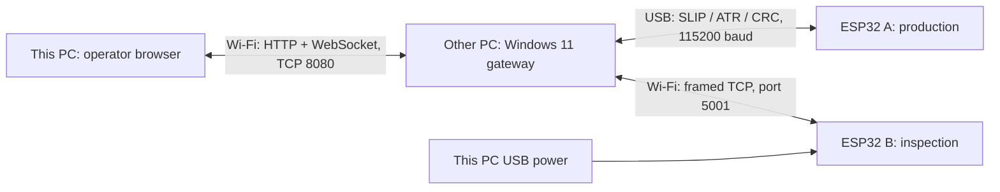

# Two-PC, two-ESP32 setup: phone hotspot

Setup only. Do not press Start or run a batch yet. Functional test cases,
fault injection and requested test outputs come in a separate exchange after
we confirm this setup. No physical tests or flashing were performed by this review.

## 1. Connections and why the operator must join



The phone provides the Wi-Fi LAN. **Connect this operator PC, the gateway PC
and B to that same phone hotspot.** The operator browser must reach the
gateway's private LAN address directly; being connected to a different Wi-Fi
network does not create that route. Internet access alone is insufficient.
B's USB cable does not bridge the PCs or carry inspection jobs in this application.
A uses USB and does not need Wi-Fi. There are no additional sensors or A-to-B wires.

Keep the currently working phone-hotspot settings. A standard ESP32 needs
compatible 2.4 GHz Wi-Fi; its current application expects WPA2-compatible
credentials. Keep the phone powered and its hotspot enabled. Some hotspots
isolate clients; if the operator cannot reach the gateway despite correct IPs
and firewall settings, we must resolve that network limitation before testing.
The PDF defaults to a gateway-hosted hotspot and permits a team-owned router;
record your phone-hosted topology explicitly in the demonstration setup.

## 2. Record actual addresses and ports

| Value | Obtain it from | Reported/example value |
| --- | --- | --- |
| GATEWAY_IP | `ipconfig` on the gateway, hotspot Wi-Fi adapter | Example: 172.20.10.2 |
| OPERATOR_IP | `ipconfig` on this PC after joining the hotspot | Example: 172.20.10.4 |
| B_IP | B's current boot log or phone connected-device list | Example: 172.20.10.3 |
| A_COM | Gateway Device Manager / Ports, identifying A | You reported COM3; verify there |
| B_COM | This PC's port for B, only for flashing/boot log | You reported COM6; verify here |

The IPs above are examples, not detected assignments. GATEWAY_IP means the
gateway PC's own Wi-Fi IPv4, not the phone's default-gateway address and not
B_IP. DHCP IPs and COM numbers can change; COM numbers can differ between PCs.
This PC was on 192.168.1.201 when inspected, which does not establish that it
has joined the project hotspot. Read its address again after joining.

Use stable USB power. A needs a data-capable cable throughout operation.
B needs a data cable only for flashing/serial monitoring; otherwise USB power
is sufficient. If a COM port is absent, identify the board's USB-UART chip and
install its manufacturer's recommended driver. Do not guess which board to flash.

## 3. Firmware: no reflash needed for these PC-side changes

You confirmed the integrated versions and supplied:

```powershell
idf.py -C member2/esp32_b_inspection -p COM6 app-flash
idf.py -C member1/production-a/firmware -p COM3 -b 115200 app-flash
```

These select the integrated project locations. No ESP firmware source changed
in the operator/two-PC review, so **do not reflash just for this setup update**.
Keep B's working Wi-Fi configuration and normal application mode. Its optional
test-only echo diagnostic must remain disabled. Original contributor-branch
firmware or B's Wi-Fi-only skeleton would not match the integrated application.

`app-flash` updates the application only; it assumes a compatible bootloader
and partition table already exist. A new/uninitialized board needs a full
`flash`. Do not erase/reset/reflash a station to clear uncertain work once
testing begins: it changes boot identity and loses volatile station history.

If later a real firmware change is needed, use the appendix below; none is
currently required. Do not flash old build-evidence B images: those use
placeholder network settings, not your phone credentials.

## 4. Update and install the GATEWAY PC software

Only the other PC runs the Python gateway. This operator PC needs a browser;
it does not need a local UI server, Node/npm or a second gateway. ESP-IDF is
only needed on a PC that flashes firmware, not to run the gateway.

Use the existing Networks_Project checkout on the gateway. Check for local
changes, then update main without discarding anything:

```powershell
Set-Location C:\MCT431\Networks_Project
git status --short
git switch main
git pull --ff-only
git rev-parse --short HEAD
```

Replace the first path with that PC's actual repository location. If Git
reports changes/conflicts/divergence, send the message; do not reset or delete
work. If there is no checkout, install Git and clone:

```powershell
git clone --branch main https://github.com/mariam-mhmaa/Networks_Project.git C:\MCT431\Networks_Project
```

Use the new setup-audit commit in addition to the earlier operator integration
29b21e7; the final handoff identifies its exact commit. At the repository root,
in ordinary PowerShell, install the verified Python 3.11 environment:

```powershell
py -3.11 -m venv .venv
.\.venv\Scripts\python.exe -m pip install -r gateway/operator/requirements.txt
.\.venv\Scripts\python.exe --version
```

If Python 3.11 is missing, install it or use your verified compatible Python
path to create the venv. Calling its Python directly avoids PowerShell script
activation/policy changes. Keep this runtime separate from the ESP-IDF terminal.
Downloads need internet; the finished system communicates locally.

## 5. Prepare network access on the Windows 11 GATEWAY PC

Join the phone hotspot on both PCs. Record their hotspot-adapter IPv4 addresses
using `ipconfig`; do not choose a VPN, Ethernet or disconnected adapter address.
Close any extra operator browser tabs, including a local one on the gateway:
one panel holds the control lease. Keep both PCs awake during the supervised
session and keep the operator tab visible to avoid browser background throttling.

The operator needs inbound TCP **8080 on the gateway**. B listens on TCP 5001
and the gateway connects outward to it. Opening inbound 5001 on the gateway
does not fix B reachability. There is no router port-forwarding step.

If Windows blocks the browser connection, open Administrator PowerShell on
the GATEWAY PC and add this narrowly scoped rule, substituting actual IPs:

```powershell
$gatewayIp = '172.20.10.2'
$operatorIp = '172.20.10.4'
New-NetFirewallRule -DisplayName 'MCT431 operator TCP 8080' -Direction Inbound -Action Allow -Protocol TCP -LocalPort 8080 -LocalAddress $gatewayIp -RemoteAddress $operatorIp -Profile Any
```

This limits access to the selected listener and operator IP even if Windows
labels the hotspot Public. Update the rule if either address changes. Do not
disable the firewall. To remove this dedicated rule after the session:

```powershell
Remove-NetFirewallRule -DisplayName 'MCT431 operator TCP 8080'
```

No firewall/hotspot settings have been changed automatically by this review.

## 6. Start the gateway on the OTHER PC

Keep A connected there by USB. Keep B powered from this PC and connected to
the phone hotspot. Close A's serial monitor, old A/B exercise clients and any
mock gateway. Only one process may own A's COM port/B's TCP connection.

At the gateway repository root in ordinary PowerShell:

```powershell
.\.venv\Scripts\python.exe -B -m gateway.operator COM3 172.20.10.3 --host 172.20.10.2 --port 8080 --inspection-port 5001 --state-file gateway.sqlite3 --serial-trace serial.local.jsonl
```

Substitute A_COM, B_IP and GATEWAY_IP. Here COM3 is A, the first IP is B,
and **--host is the gateway PC's own hotspot address**. That --host option is
essential because the default 127.0.0.1 accepts only same-PC browser access.
Binding the specific LAN address avoids unrelated PC interfaces. If its IP
changes, restart setup with the correct address. 0.0.0.0 can be a listen address,
but is never the destination typed into a browser.

Leave this terminal running. Expect the evidence path and Uvicorn listener
message. Discovery obtains station heartbeats; it does not start production.

## 7. Open the screen on THIS operator PC

After joining the phone hotspot, open this in the browser:

```text
http://172.20.10.2:8080/
```

Use the actual GATEWAY_IP. The gateway serves the screen, HTTP commands and
WebSocket status from the same origin. Do not double-click index.html, start
the contributor mock/static server or use localhost here: localhost means
this operator PC. The Gateway address field must show the same origin; correct
a remembered old address and click Connect if needed.

Setup readiness is: Gateway live (not Test gateway live), A and B connected,
Idle and no pending command. A previously closed batch can retain its genuine
report; a new station pair has no batch. **Do not press Start yet.** Live status
establishes setup readiness, not a passed production test.

If an earlier session left an open run, the screen shows Fault/old runs. Save
the evidence first. Close old station runs requires both stations fresh/idle
and closes their scope without reconstructing missing old results. If an ESP
restarted between ended batches, Recover restarted A/B explicitly confirms
its different idle boot. Neither action produces parts. If unfinished evidence
matters, send the state before closing/resetting anything.

If the page does not load, check the gateway address/listener, startup errors,
shared hotspot, scoped firewall rule and phone client isolation. If the page
loads but A is disconnected, check A_COM/cable/serial ownership/firmware. If B
is disconnected, check its power, current IP, normal application, TCP 5001 and
any old client occupying its single TCP session. Do not interpret stale UI
values as current device information.

## 8. Evidence preparation and setup checkpoint

Keep these files on the gateway:

- gateway.sqlite3: durable part counter, operation/accounting/control events,
  batch history and persistent short ID labels.
  Reuse it across restarts; do not delete it to bypass recovery.
- serial.local.jsonl: append-only raw A serial capture sessions.
  A serial_tx/serial_rx hex records preserve SLIP/ATR/CRC bytes
  and local observation times. RX entries are chunks, not assumed whole messages.
  A bounded background writer keeps file writes off the event loop. Capture
  status exposes errors/dropped records; an errored capture is incomplete.
- Later: Wireshark .pcapng, manually downloaded batch-N.json and browser notebook.
  JSONL does not replace the PDF's TCP packet capture. Install Wireshark with
  its Windows capture driver on the gateway in advance; capture selection and
  actual recording belong to the later test phase.

Keep the old gateway.local.jsonl from earlier tests as well. See
[batch-history.md](batch-history.md) for the History screen, report fields,
gateway update and compressed log-transfer instructions.

For setup confirmation only, send (without Wi-Fi passwords):

1. GATEWAY_IP, OPERATOR_IP, B_IP and confirmed A_COM.
2. Exact gateway Git HEAD, Python version and launch command.
3. Gateway startup messages/errors and the screen's state/station indicators.
4. If useful, save http://GATEWAY_IP:8080/api/status JSON. This is read-only.

We will resolve setup mismatches first. In the next phase I will give controlled
test cases separately and request their exact outputs/logs. No hardware PASS
is claimed now. To shut down before any batch, Ctrl+C in the gateway terminal.
After testing starts, use the operator Stop workflow and preserve the batch
report before shutting down; do not power-cycle to clear unknown outcomes.

## Appendix: flashing only if actually needed later

This PC has ESP-IDF v6.1.1. Activate it in a separate flashing terminal:

```powershell
. C:\Espressif\activate-networks.ps1
idf.py --version
```

Use a short checkout without spaces, such as C:\MCT431\Networks_Project, for
ESP-IDF builds. Keep the full repository layout for shared/station references.
Do not reuse stale staging copies. Confirm classic ESP32 hardware before
`set-target esp32`; another chip needs an explicitly appropriate configuration.
On a fresh project, set-target initializes settings and may replace an existing
local configuration, so do not repeat it casually during later tuning.

For A, close the gateway/serial monitor; in its project directory build and
flash the verified COM port:

```powershell
Set-Location C:\MCT431\Networks_Project\member1\production-a\firmware
idf.py build
idf.py -p COM3 -b 115200 app-flash
```

A needs no Wi-Fi settings. Its normal binary serial stream can look unreadable
in a text monitor; close that monitor before starting the gateway. If only this
PC has ESP-IDF, temporarily move A here for flashing then return it to the
gateway, identifying its COM port separately on each PC.

For B, in its project directory run menuconfig only if network settings or mode
must change. Inspection Station Wi-Fi holds the real local SSID/password;
Inspection Station TCP should have port 5001 and test-only echo disabled.
Times/N/K are configured by the operator at runtime, not here.

```powershell
Set-Location C:\MCT431\Networks_Project\member2\esp32_b_inspection
idf.py menuconfig
idf.py build
idf.py -p COM6 app-flash
idf.py -p COM6 monitor
```

Record `Inspection protocol v1 boot=` and `Wi-Fi connected; IPv4 address:`.
Exit monitor with Ctrl+] while leaving USB power connected. Opening a monitor
can reset some boards, so do this only before a batch. For a new board use
`flash` instead of `app-flash` to include bootloader/partition table. If upload
stalls, verify cable/port and the board's BOOT/EN procedure; do not erase flash
or select a different target to bypass an unexplained error. Keep passwords,
sdkconfig and credential-bearing B binaries out of shared outputs/Git.

## Sources and limits

The official PDF in reference/ governs: network roles/default topology on
page 1, runtime configuration on pages 2-3, Milestone 1 on page 5. The team
development guide is a proposal. Formal benchmarks, MQTT/Modbus migration and
Milestone 2 authentication are separate work. Review/native tests cannot prove
physical drivers, hotspot reachability or timing; those remain to be measured.

- [Espressif Windows build/flash/monitor instructions](https://docs.espressif.com/projects/esp-idf/en/v6.1.1/esp32/get-started/windows-start-project.html)
- [Microsoft firewall-rule parameters](https://learn.microsoft.com/powershell/module/netsecurity/new-netfirewallrule)
- [Wireshark capture capabilities](https://www.wireshark.org/docs/wsug_html_chunked/ChapterIntroduction.html)
